# 康复训练辅助平台 · 管理端（web-admin）API 开发标准文档

## 修改记录

| 版本 | 作者 | 内容 | 日期 |
| --- | --- | --- | --- |
| v1.0 | TraeCode | 依据 M1~M4 已交付源码整理管理端全部 56 个 REST 接口 | 2026-10-01 |

# 需求背景

基于 Spring Boot + MoveNet 模型的人体姿态评估康复训练辅助平台，为系统管理员提供统一的后台管理能力：账号与医患绑定治理、动作库与算法版本治理、公共内容审核与文件存储、平台公告/字典/审计/数据库备份恢复，保障平台数据资产的可管、可控、可追溯。

# 功能需求

| 里程碑 | 功能域 | 说明 |
| --- | --- | --- |
| M1 | 账号与绑定管理 | 患者/治疗师账号创建（同步建档）、查询、启停、重置密码、登录日志；医患主责/协作绑定的建立、变更、解除 |
| M2 | 动作库、规则与模板 | 动作基础信息 CRUD 与下线；动作版本（算法配置/运动签名）创建与发布（**版本不可变**）；评估规则 CRUD（权重和=1 方可发布）；标准模板（归一化特征序列）管理与发布 |
| M3 | 公共内容审核与文件 | 健康内容草稿/审核（APPROVE/REJECT/OFFLINE）/删除；MinIO 预签名直传（presign→PUT→complete 三段式，SHA-256 校验）与文件预览/删除 |
| M4 | 公告、字典与运维 | 平台公告（草稿→发布→下架，有效期与可见范围）；康复部位字典 CRUD（删除前 4 表引用校验）；操作审计日志查询；数据库逻辑备份/恢复（一次性确认码 + 恢复前安全快照 + 快照回退） |

# 系统架构设计

```
┌──────────────────────────────────────────────────────────────┐
│ 前端 Vue3 (modules/admin)  ──HTTPS──►  Nginx / Vite 代理      │
└──────────────────────────────────────────────────────────────┘
                     │ /api/v1/admin/**（Bearer JWT，仅 ADMIN）
┌──────────────────────────────────────────────────────────────┐
│ backend（Maven 多模块）                                        │
│  web-admin  Controller → Service(+Impl) → @OperationLog 审计   │
│  web-app    共享 Service（字典等）                              │
│  model      Entity / DTO / Mapper(BaseMapper) / enums         │
│  common     ApiResult / PageResult / ResultCode / 全局异常      │
└───────┬──────────────┬──────────────────┬────────────────────┘
        ▼              ▼                  ▼
   MySQL 8.0      Redis 7            MinIO
  rehab_platform  验证码/令牌/锁/     文件对象存储
                  直传会话/备份锁     （预签名直传）
```

关键机制：

- **统一前缀**：`server.servlet.context-path=/api/v1`，本文所有路径均已含此前缀。
- **统一响应**：`ApiResult{code, msg, data}`，成功 `code="0"`；分页结构 `PageResult{records, page, size, total}`（page 从 1 开始）。
- **安全**：Spring Security 拦截 `/admin/**` 要求 ADMIN 角色；JWT Bearer 认证；禁用账号令牌立即失效。
- **审计**：全部写操作经 `@OperationLog` 切面落 `operation_log`（模块/动作/目标/参数/IP/结果）；查询类端点不记录。
- **数据库迁移**：Flyway（V1 基线 ~ V3 db_backup_task），`flyway_schema_history` 不参与逻辑备份。

# 状态机

## 动作 / 动作版本（M2）

```plantuml
@startuml
[*] --> DRAFT : 创建
DRAFT --> PUBLISHED : 发布版本\n(权重和=1, JSON 合法,\nposeEngineId 非空)
PUBLISHED --> DEPRECATED : 新版本发布后旧版本归档
DRAFT --> DRAFT : 可编辑
PUBLISHED --> [x] : 修改/删除被拒\n409 VERSION_IMMUTABLE
note right of PUBLISHED : 动作本体随首个版本发布\nDRAFT→PUBLISHED；可 OFFLINE(下线)
@enduml
```

## 公共内容（M3）

```plantuml
@startuml
[*] --> DRAFT : 创建
DRAFT --> PUBLISHED : APPROVE(publishedAt=now)
PENDING_REVIEW --> PUBLISHED : APPROVE
PENDING_REVIEW --> DRAFT : REJECT(comment 必填)
DRAFT --> DRAFT : REJECT(记录 reviewerId+reviewRemark)
PUBLISHED --> OFFLINE : OFFLINE
PUBLISHED --> [x] : PUT/DELETE 被拒 409 STATE_CONFLICT
DRAFT --> [*] : DELETE(级联清理附件/收藏)
OFFLINE --> [*] : DELETE
note right of DRAFT : 编辑草稿会清空\nreviewerId/reviewRemark
@enduml
```

## 平台公告（M4）

```plantuml
@startuml
[*] --> DRAFT : 创建(有效期缺省 now~now+30d)
DRAFT --> PUBLISHED : publish(startTime,endTime 必填\n且 end>=start)
OFFLINE --> PUBLISHED : 重新发布(同上校验)
PUBLISHED --> OFFLINE : offline
PUBLISHED --> [x] : PUT/DELETE 被拒 409
DRAFT --> [*] : DELETE
OFFLINE --> [*] : DELETE
note right of PUBLISHED : 端侧可见性 = PUBLISHED\n且 now∈[start,end]\n且 scope 匹配角色
@enduml
```

## 备份任务（M4）

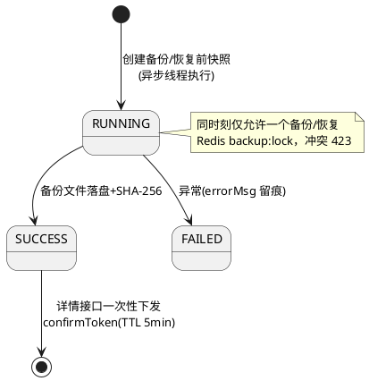

## 医患绑定（M1）

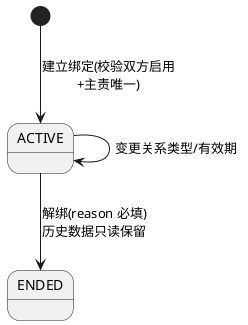

# 数据模型

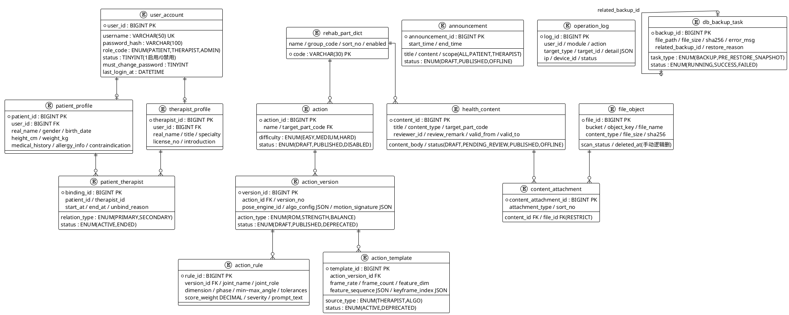

# 技术栈

```plantuml
@startuml
!theme plain
rectangle "前端" {
  [Vue 3 + TypeScript] as vue
  [Element Plus] as ep
  [Pinia / Vue Router] as pinia
  [Vite] as vite
}
rectangle "后端" {
  [Spring Boot 3.x] as sb
  [Spring Security + JWT] as sec
  [MyBatis-Plus 3.x] as mp
  [SpringDoc / Knife4j] as knife
  [Flyway] as fly
  [EasyCaptcha 1.6.2] as cap
  [Hutool] as hutool
}
rectangle "基础设施(192.168.10.102)" {
  database "MySQL 8.0\nrehab_platform" as mysql
  [Redis 7\n验证码/令牌/分布式锁] as redis
  [MinIO\n文件对象存储] as minio
}
vue --> sb : HTTPS /api/v1
sb --> sec
sb --> mp --> mysql
sb --> redis
sb --> minio : 预签名直传
sb --> knife
sb --> fly --> mysql
sb --> cap
sb --> hutool
@enduml
```

# 配置信息

| 配置项 | 位置 | 说明 |
| --- | --- | --- |
| 服务端口 / 全局前缀 | `application.yml` → `server.port` / `server.servlet.context-path` | 默认 8080；**`/api/v1`**（本文路径已含） |
| MySQL | `application-dev.yml` | `192.168.10.102:3306/rehab_platform`，账号 root |
| Redis | `application-dev.yml` | `192.168.10.102:6379`（验证码/令牌/互斥锁/直传会话） |
| MinIO | `application-dev.yml`（仅 yml 配置，Java 无硬编码默认） | `192.168.10.102:9000`，bucket 懒创建 |
| JWT 密钥 / 过期 | `application-prod.yml` → `${ENV_VAR:default}` | 生产用环境变量注入 |
| Knife4j | 生产环境四层关闭：`knife4j.production/enable`、`springdoc.api-docs/swagger-ui.enabled` | 开发环境文档地址 `/api/v1/doc.html` |
| 备份目录 | `rehab.backup.dir`（env `REHAB_BACKUP_DIR`，默认 `data/backups`） | 生产需挂持久卷 |
| 验证码 | Redis `auth:captcha:{id}`，TTL 120s，取出即删 | SpecCaptcha(130,38,4) |
| 恢复确认码 | Redis `backup:confirm:{id}`，TTL 5min，一次性 | 见备份恢复接口 |

---

# 详细设计

**公共请求头**（除标注外全部接口适用）：

| 参数名称 | 参数类型 | 是否必填 | 说明 |
| :--- | :--- | :--- | :--- |
| Authorization | string | 是 | `Bearer {accessToken}`，须为 ADMIN 角色；无 token → 401 AUTH_REQUIRED，非 ADMIN → 403 FORBIDDEN |
| Content-Type | string | 请求体存在时必填 | application/json |

**统一响应**：成功 `{"code":"0","msg":"OK","data":...}`；失败 `{"code":"<错误码>","msg":"...","data":null}`（参数错误时 data 可携带 fieldErrors）。分页 data 固定为 `{"records":[...],"page":1,"size":20,"total":N}`。

---

## 模块一：账号管理（AdminUserController，/admin/users）

### 1.1 分页查询账号

#### 时序图
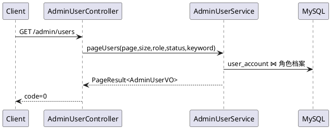

#### 接口设计
接口地址：`GET /api/v1/admin/users`

请求参数（Query）：

| 参数名称 | 参数类型 | 是否必填 | 说明 | 验证规则 |
| :--- | :--- | :--- | :--- | :--- |
| page | int | 否 | 页码，从 1 开始 | 默认 1 |
| size | int | 否 | 每页条数 | 默认 20 |
| role | string | 否 | 角色码筛选 | PATIENT / THERAPIST / ADMIN |
| status | int | 否 | 账号状态 | 1 启用 / 0 禁用 |
| keyword | string | 否 | 登录名/姓名模糊 | — |

响应参数 `data.records[]`（AdminUserVO）：`userId`、`username`、`roleCode`、`roleName`、`phone`（脱敏 `138****8000`）、`realName`、`status`、`lastLoginAt`、`createdAt`。

### 1.2 创建患者/治疗师账号

#### 时序图
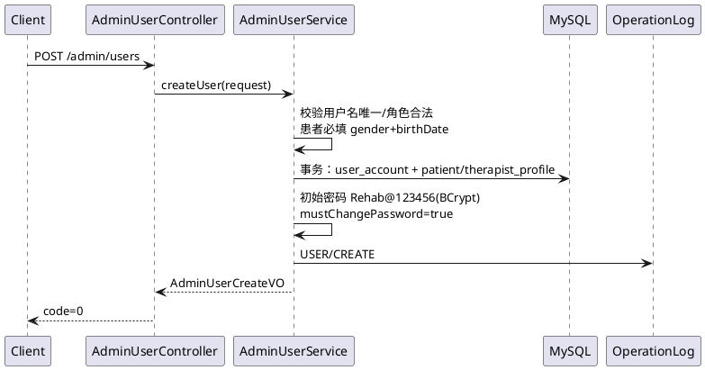

#### 接口设计
接口地址：`POST /api/v1/admin/users`

请求参数（Body，AdminUserCreateRequest）：

| 参数名称 | 参数类型 | 是否必填 | 说明 | 验证规则 |
| :--- | :--- | :--- | :--- | :--- |
| username | string | 是 | 登录名 | 字母开头，仅字母/数字/下划线，4~50 位 |
| roleCode | string | 是 | 角色 | 仅 PATIENT / THERAPIST（不可创建 ADMIN） |
| phone | string | 否 | 手机号 | `^1[3-9]\d{9}$` |
| realName | string | 是 | 真实姓名 | ≤50 字 |
| gender | string | 患者必填 | 性别 | M / F / U |
| birthDate | date | 患者必填 | 出生日期 | yyyy-MM-dd |
| heightCm | number | 否 | 身高(cm)（患者） | — |
| weightKg | number | 否 | 体重(kg)（患者） | — |
| medicalHistory | string | 否 | 既往病史 | ≤1000 字 |
| allergyInfo | string | 否 | 过敏史 | ≤500 字 |
| contraindication | string | 否 | 禁忌症 | ≤500 字 |
| title | string | 否 | 职称（治疗师） | ≤50 字 |
| specialty | string | 否 | 专长领域（治疗师） | ≤200 字 |
| licenseNo | string | 否 | 执业证书编号（治疗师） | ≤50 字 |
| introduction | string | 否 | 个人简介（治疗师） | ≤500 字 |

响应参数 `data`（AdminUserCreateVO）：

```json
{
  "code": "0",
  "msg": "OK",
  "data": {
    "userId": 1001,
    "username": "patient01",
    "roleCode": "PATIENT",
    "initialPasswordDelivered": false,
    "mustChangePassword": true
  }
}
```

业务错误码：400 VALIDATION_ERROR（患者缺 gender/birthDate）、409 DUPLICATE_RESOURCE（用户名已存在）。初始密码固定 `Rehab@123456`，**不回显明文**，线下交付。

### 1.3 查询账号详情

接口地址：`GET /api/v1/admin/users/{userId}`

路径变量：`userId`（账号ID）。无请求体。

响应 `data`（AdminUserDetailVO）：账号字段（`userId/username/roleCode/roleName/phone`完整手机号`/status/lastLoginAt/createdAt`）+ 角色档案（患者：`realName/gender/birthDate/heightCm/weightKg/medicalHistory/allergyInfo/contraindication`；治疗师：`realName/title/specialty/licenseNo/introduction`）。

错误码：404 NOT_FOUND。

### 1.4 修改账号非敏感资料

接口地址：`PUT /api/v1/admin/users/{userId}`

请求体（AdminUserUpdateRequest，**全部字段可选**，仅更新传入字段）：`phone`、`realName`、`gender`、`birthDate`、`heightCm`、`weightKg`、`medicalHistory`、`allergyInfo`、`contraindication`、`title`、`specialty`、`licenseNo`、`introduction`（校验规则同 1.2）。用户名/角色/密码不在此修改。

响应：`data=null`。错误码：400 VALIDATION_ERROR、404 NOT_FOUND。审计：USER/UPDATE。

### 1.5 启用账号

接口地址：`POST /api/v1/admin/users/{userId}/enable`，无请求体。响应 `data=null`。错误码：404、409 STATE_CONFLICT（已启用）。审计：USER/ENABLE。

### 1.6 禁用账号

接口地址：`POST /api/v1/admin/users/{userId}/disable`

请求体（ReasonRequest）：

| 参数名称 | 参数类型 | 是否必填 | 说明 | 验证规则 |
| :--- | :--- | :--- | :--- | :--- |
| reason | string | 是 | 禁用原因（写审计） | ≤200 字 |

响应 `data=null`。**禁用后该账号全部 JWT 立即失效**。错误码：404、409 STATE_CONFLICT。审计：USER/DISABLE。

### 1.7 重置密码

接口地址：`POST /api/v1/admin/users/{userId}/reset-password`，无请求体。重置为平台初始密码（不返回明文），`mustChangePassword` 置 true。响应 `data=null`。错误码：404。审计：USER/RESET_PASSWORD。

### 1.8 分页查询账号登录日志

接口地址：`GET /api/v1/admin/users/{userId}/login-logs`

Query：`page`（默认1）、`size`（默认20）、`success`（可选，true 仅成功 / false 仅失败）。

响应 `data.records[]`（LoginLogVO，来源 operation_log module=AUTH）：`logId`、`userId`、`action`(LOGIN/LOGOUT)、`status`(SUCCESS/FAIL)、`ip`、`deviceId`、`message`（失败原因，自 detail JSON 解析）、`createdAt`。

---

## 模块二：绑定关系管理（AdminBindingController，/admin/bindings）

### 2.1 分页查询绑定关系

接口地址：`GET /api/v1/admin/bindings`

Query：`page`、`size`、`patientId`（可选）、`therapistId`（可选）、`status`（ACTIVE/ENDED）。

响应 `data.records[]`（BindingVO）：`bindingId`、`patientId`、`patientName`、`therapistId`、`therapistName`、`relationType`(PRIMARY/SECONDARY)、`relationTypeName`、`status`(ACTIVE/ENDED)、`statusName`、`startAt`、`endAt`（空=长期）、`createdBy`、`createdAt`。

### 2.2 建立绑定

#### 时序图
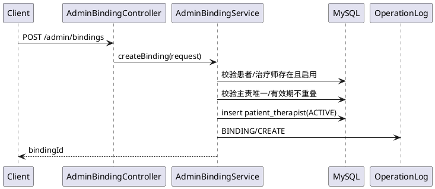

接口地址：`POST /api/v1/admin/bindings`

请求体（BindingCreateRequest）：

| 参数名称 | 参数类型 | 是否必填 | 说明 | 验证规则 |
| :--- | :--- | :--- | :--- | :--- |
| patientId | long | 是 | 患者用户ID | — |
| therapistId | long | 是 | 治疗师用户ID | — |
| relationType | string | 是 | 关系类型 | PRIMARY 主责 / SECONDARY 协作 |
| startAt | datetime | 否 | 生效时间，默认立即 | — |
| endAt | datetime | 否 | 失效时间，空=长期 | — |

响应 `data`：`bindingId`（long）。

错误码：404 NOT_FOUND（账号不存在）、409 BINDING_CONFLICT（主责治疗师已存在/有效期冲突）、409 STATE_CONFLICT（账号被禁用）。

### 2.3 变更绑定

接口地址：`PUT /api/v1/admin/bindings/{bindingId}`

请求体（BindingUpdateRequest，字段可选）：`relationType`、`startAt`、`endAt`。仅 ACTIVE 绑定可变更。

响应 `data=null`。错误码：404、409 STATE_CONFLICT（已解绑）、409 BINDING_CONFLICT。审计：BINDING/UPDATE。

### 2.4 解除绑定

接口地址：`POST /api/v1/admin/bindings/{bindingId}/unbind`

请求体：ReasonRequest（`reason` 必填 ≤200 字）。解绑为状态流转（ACTIVE→ENDED），**历史训练/计划数据只读保留，不物理删除**。

响应 `data=null`。错误码：404、409 STATE_CONFLICT。审计：BINDING/UNBIND。

---

## 模块三：动作管理（AdminActionController，/admin/actions）

### 3.1 分页查询动作

接口地址：`GET /api/v1/admin/actions`

Query：`page`、`size`、`targetPart`（部位编码）、`status`（DRAFT/PUBLISHED/DISABLED）、`keyword`（名称模糊）。

响应 `data.records[]`（AdminActionVO）：`actionId`、`name`、`targetPartCode`、`targetPartName`、`difficulty`(EASY/MEDIUM/HARD)+`difficultyName`、`status`+`statusName`、`createdAt`。

### 3.2 创建动作

接口地址：`POST /api/v1/admin/actions`

请求体（ActionSaveRequest）：

| 参数名称 | 参数类型 | 是否必填 | 说明 | 验证规则 |
| :--- | :--- | :--- | :--- | :--- |
| name | string | 是 | 动作名称 | ≤100 字 |
| targetPartCode | string | 是 | 目标康复部位编码 | ≤30 字，**必须命中 rehab_part_dict 编码** |
| difficulty | string | 是 | 难度 | EASY / MEDIUM / HARD |
| description | string | 否 | 动作说明 | ≤1000 字 |

响应 `data`：`actionId`。创建后状态 DRAFT。错误码：400 VALIDATION_ERROR（部位编码不存在）。审计：ACTION/CREATE。

### 3.3 查询动作详情

接口地址：`GET /api/v1/admin/actions/{actionId}`

响应 `data`（AdminActionDetailVO）：动作全部字段 + `description`、`createdBy`、`updatedAt`、`versionList`（AdminActionVersionVO 数组，按 versionNo 降序）。错误码：404。

### 3.4 修改动作基础信息

接口地址：`PUT /api/v1/admin/actions/{actionId}`，请求体同 3.2。**仅 DRAFT 可编辑**。错误码：404、409 STATE_CONFLICT。审计：ACTION/UPDATE。

### 3.5 动作下线

接口地址：`POST /api/v1/admin/actions/{actionId}/offline`，无请求体。状态 → DISABLED；治疗师端新建计划的动作下拉不再出现。错误码：404、409 STATE_CONFLICT。审计：ACTION/OFFLINE。

---

## 模块四：动作版本管理（AdminActionVersionController，无类级前缀）

### 4.1 分页查询动作版本

接口地址：`GET /api/v1/admin/action-versions`

Query：`page`、`size`、`actionId`（可选）、`status`（DRAFT/PUBLISHED/DEPRECATED）。

响应 `data.records[]`（AdminActionVersionVO）：`versionId`、`actionId`、`versionNo`、`actionType`(ROM/STRENGTH/BALANCE)+`actionTypeName`、`poseEngineId`、`status`+`statusName`、`createdAt`。

### 4.2 创建动作版本

#### 时序图
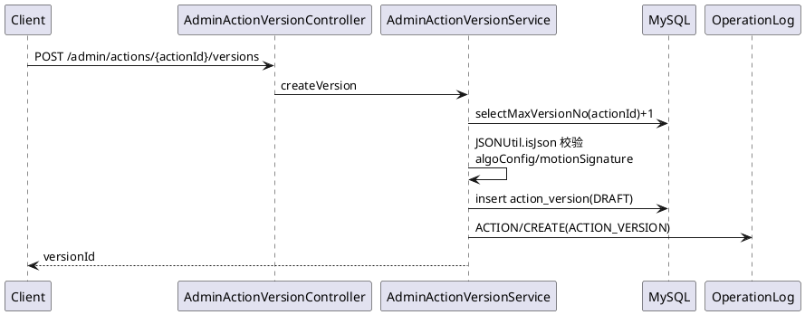

接口地址：`POST /api/v1/admin/actions/{actionId}/versions`

请求体（ActionVersionSaveRequest）：

| 参数名称 | 参数类型 | 是否必填 | 说明 | 验证规则 |
| :--- | :--- | :--- | :--- | :--- |
| actionType | string | 是 | 动作类型 | ROM 关节活动度 / STRENGTH 力量 / BALANCE 平衡 |
| poseEngineId | string | 是 | 姿态引擎标识 | ≤100 字，如 `movenet-lightning-v4` |
| algoConfig | string(JSON) | 否 | 算法配置（置信度阈值/平滑窗口/阶段状态机/六维权重等 21 字段） | ≤4000 字，非空须为合法 JSON，缺省落 `"{}"` |
| motionSignature | string(JSON) | 否 | 运动特征签名 | ≤8000 字，非空须为合法 JSON，缺省落 `"{}"` |

响应 `data`：`versionId`（versionNo 自动递增）。错误码：404（动作不存在）、400 VALIDATION_ERROR（非法 JSON）。审计：ACTION/CREATE。

### 4.3 查询版本详情

接口地址：`GET /api/v1/admin/action-versions/{versionId}`

响应 `data`（AdminActionVersionDetailVO）：版本全字段（含 `algoConfig`/`motionSignature` 原文）+ `ruleList`（AdminActionRuleVO[]）+ `templateList`（AdminActionTemplateVO[]）。错误码：404 VERSION_NOT_FOUND。

### 4.4 修改版本

接口地址：`PUT /api/v1/admin/action-versions/{versionId}`，请求体同 4.2。**仅 DRAFT 可编辑，已发布返回 409 VERSION_IMMUTABLE**。审计：ACTION/UPDATE。

### 4.5 发布版本

#### 时序图
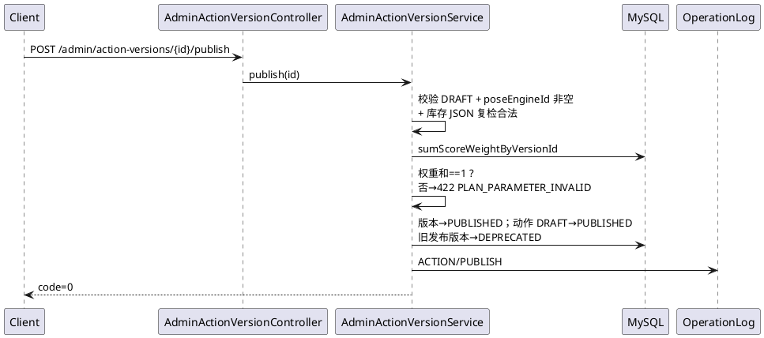

接口地址：`POST /api/v1/admin/action-versions/{versionId}/publish`，无请求体。

前置校验：版本为 DRAFT、poseEngineId 非空、algoConfig/motionSignature 为合法 JSON、**规则 scoreWeight 之和=1**。错误码：404 VERSION_NOT_FOUND、409 STATE_CONFLICT（非草稿）、422 PLAN_PARAMETER_INVALID（权重和≠1 或无规则）。审计：ACTION/PUBLISH。

---

## 模块五：动作规则管理（AdminActionRuleController，/admin/action-versions/{versionId}/rules）

### 5.1 查询规则列表

接口地址：`GET /api/v1/admin/action-versions/{versionId}/rules`（无分页，返回全量数组）

响应 `data[]`（AdminActionRuleVO）：`ruleId`、`jointName`、`keypointIndices`(JSON)、`angleFormula`、`jointRole`(PRIMARY/AUXILIARY)、`dimension`(ANGLE/STABILITY/SYMMETRY/HOLD/SPEED)、`phase`(START/CONCENTRIC/ECCENTRIC/HOLD/FULL)、`minAngle/maxAngle/standardAngle`、`toleranceSoft/toleranceHard`、`holdFramesRequired`、`speedMin/speedMax`、`scoreWeight`、`severity`、`promptText`、`symmetryPairRuleId`、`createdAt/updatedAt`。

### 5.2 创建规则

接口地址：`POST /api/v1/admin/action-versions/{versionId}/rules`

请求体（ActionRuleRequest）：

| 参数名称 | 参数类型 | 是否必填 | 说明 | 验证规则 |
| :--- | :--- | :--- | :--- | :--- |
| jointName | string | 是 | 关节名称（如 left_knee） | ≤50 字 |
| keypointIndices | string(JSON) | 否 | 关键点索引数组（如 `[23,25,27]`） | ≤500 字，缺省 `"[]"` |
| angleFormula | string | 否 | 角度计算公式 | ≤255 字 |
| jointRole | string | 是 | 关节角色 | PRIMARY / AUXILIARY |
| dimension | string | 是 | 评估维度 | ANGLE/STABILITY/SYMMETRY/HOLD/SPEED |
| phase | string | 是 | 动作阶段 | START/CONCENTRIC/ECCENTRIC/HOLD/FULL |
| minAngle / maxAngle / standardAngle | number | 否 | 角度阈值（度） | — |
| toleranceSoft / toleranceHard | number | 否 | 软/硬容差（度） | — |
| holdFramesRequired | int | 否 | 保持所需帧数 | ≥0 |
| speedMin / speedMax | number | 否 | 速度区间（度/秒） | — |
| scoreWeight | number | 否 | 评分权重 | 0~1（发布时总和须=1） |
| severity | int | 否 | 严重等级 | ≥1，缺省 1 |
| promptText | string | 否 | 纠错提示文案 | ≤255 字 |
| symmetryPairRuleId | long | 否 | 对称评估配对规则ID（同版本内） | — |

响应 `data`：`ruleId`。错误码：404 VERSION_NOT_FOUND、409 VERSION_IMMUTABLE（版本已发布）。审计：ACTION/CREATE。

### 5.3 修改规则

接口地址：`PUT /api/v1/admin/action-versions/{versionId}/rules/{ruleId}`，请求体同 5.2。已发布版本 → 409 VERSION_IMMUTABLE。审计：ACTION/UPDATE。

### 5.4 删除规则

接口地址：`DELETE /api/v1/admin/action-versions/{versionId}/rules/{ruleId}`，无请求体。已发布版本 → 409 VERSION_IMMUTABLE。审计：ACTION/DELETE。

---

## 模块六：动作模板管理（AdminActionTemplateController）

### 6.1 分页查询模板

接口地址：`GET /api/v1/admin/action-versions/{versionId}/templates`

Query：`page`、`size`。响应 `data.records[]`（AdminActionTemplateVO）：`templateId`、`actionVersionId`、`sourceType`(THERAPIST/ALGO)+`sourceTypeName`、`frameRate`、`frameCount`、`featureDim`、`featureSequence`(JSON 原文)、`keyframeIndex`(JSON)、`sampleCount`、`status`(ACTIVE/DEPRECATED)+`statusName`、`createdAt`。

### 6.2 创建模板

接口地址：`POST /api/v1/admin/action-versions/{versionId}/templates`

请求体（ActionTemplateSaveRequest）：

| 参数名称 | 参数类型 | 是否必填 | 说明 | 验证规则 |
| :--- | :--- | :--- | :--- | :--- |
| sourceType | string | 是 | 模板来源 | THERAPIST 治疗师录制 / ALGO 算法生成 |
| frameRate | number | 否 | 采样帧率 fps | >0，缺省 30 |
| frameCount | int | 否 | 帧数 | ≥1 |
| featureDim | int | 否 | 特征维度 | ≥1 |
| featureSequence | string(JSON) | 是 | 归一化标准特征序列（**仅存特征，不存视频帧**） | ≤20000 字 |
| keyframeIndex | string(JSON) | 否 | 关键帧索引 | ≤4000 字，缺省 `"[]"` |
| sampleCount | int | 否 | 采样样本数（多次采集取中位） | ≥1，缺省 1 |

响应 `data`：`templateId`。错误码：404 VERSION_NOT_FOUND、409 VERSION_IMMUTABLE。审计：ACTION/CREATE。

> 注意：MySQL JSON 列回读会规范化空格（`[0,45]`→`[0, 45]`），断言须结构化比较。

### 6.3 发布模板

接口地址：`POST /api/v1/admin/templates/{templateId}/publish`，无请求体。状态 → ACTIVE，发布后不可修改。错误码：404、409 STATE_CONFLICT。审计：ACTION/PUBLISH。

### 6.4 删除模板

接口地址：`DELETE /api/v1/admin/templates/{templateId}`，无请求体。**被引用时拒绝删除**（409，与 FILE_IN_USE 同款语义）；已发布模板不可删。错误码：404、409。审计：ACTION/DELETE。

---

## 模块七：公共内容审核（AdminContentController，/admin/contents）

### 7.1 分页查询内容

接口地址：`GET /api/v1/admin/contents`

Query：`page`、`size`、`status`（DRAFT/PENDING_REVIEW/PUBLISHED/OFFLINE）、`category`（内容类型）、`keyword`。

响应 `data.records[]`（AdminContentVO）：`contentId`、`title`、`contentType`(ARTICLE/VIDEO/GUIDE)+`contentTypeName`、`targetPartCode/Name`、`targetGroup`、`summary`、`status`+`statusName`、`hasReviewRemark`（草稿态"已驳回"标记）、`reviewRemark`、`validFrom/validTo`、`publishedAt`、`authorId`、`createdAt/updatedAt`。

### 7.2 创建内容草稿

接口地址：`POST /api/v1/admin/contents`

请求体（HealthContentSaveRequest）：

| 参数名称 | 参数类型 | 是否必填 | 说明 | 验证规则 |
| :--- | :--- | :--- | :--- | :--- |
| title | string | 是 | 标题 | ≤200 字 |
| contentType | string | 是 | 内容类型 | ARTICLE 图文 / VIDEO 视频 / GUIDE 指南 |
| targetPartCode | string | 否 | 关联康复部位编码 | ≤30 字 |
| targetGroup | string | 否 | 目标人群标签 | ≤200 字 |
| summary | string | 否 | 摘要 | ≤500 字 |
| contentBody | string | 是 | 正文 | ≤10000 字 |
| validFrom | datetime | 否 | 生效时间（空则发布时生效） | `yyyy-MM-dd HH:mm:ss` |
| validTo | datetime | 否 | 失效时间（空=长期） | 同上 |
| attachments | array | 否 | 附件列表（全量替换语义） | 见下 |

attachments[]（AttachmentPayload）：`fileId`（long，必填，须已通过 complete）、`attachmentType`（COVER/VIDEO/IMAGE/DOC，必填）、`sortNo`（int ≥0）。

响应 `data`：`contentId`（状态 DRAFT）。审计：CONTENT/CREATE。

### 7.3 查询内容详情

接口地址：`GET /api/v1/admin/contents/{contentId}`

响应 `data`（AdminContentDetailVO）：7.1 全部字段 + `contentBody`、`reviewerId` + `attachments[]`（ContentAttachmentVO：`contentAttachmentId/fileId/attachmentType(+Name)/sortNo/fileName/contentType/fileSize/url`（MinIO 短时预签名地址）/`urlExpiresAt`，按 sortNo 升序）。错误码：404。

### 7.4 编辑内容

接口地址：`PUT /api/v1/admin/contents/{contentId}`，请求体同 7.2。

**仅 DRAFT（含被驳回）可编辑**；附件全量替换；编辑会清空 reviewerId/reviewRemark。错误码：404、409 STATE_CONFLICT（已发布）。审计：CONTENT/UPDATE。

### 7.5 内容审核

#### 时序图
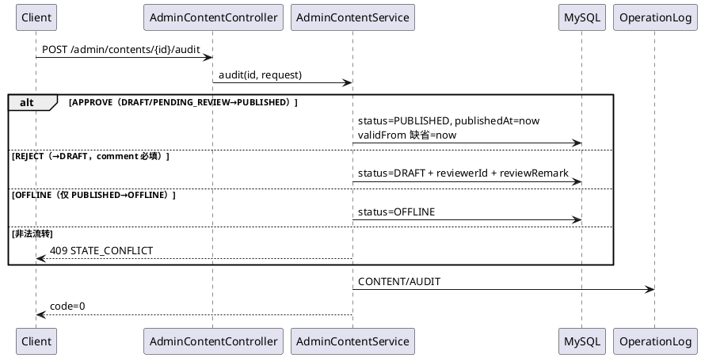

接口地址：`POST /api/v1/admin/contents/{contentId}/audit`

请求体（ContentAuditRequest）：

| 参数名称 | 参数类型 | 是否必填 | 说明 | 验证规则 |
| :--- | :--- | :--- | :--- | :--- |
| decision | string | 是 | 审核动作 | 仅 APPROVE / REJECT / OFFLINE |
| comment | string | REJECT 时必填 | 审核意见（驳回理由/下架原因） | ≤1000 字 |

响应 `data=null`。错误码：400 VALIDATION_ERROR（REJECT 缺 comment）、404、409 STATE_CONFLICT（非法流转，如对 OFFLINE 执行 APPROVE）。审计：CONTENT/AUDIT。

### 7.6 删除内容

接口地址：`DELETE /api/v1/admin/contents/{contentId}`，无请求体。

允许 DRAFT/PENDING_REVIEW/OFFLINE；**PUBLISHED 须先下架**（否则 409 STATE_CONFLICT "先下架再删除"）。同事务级联删除 content_attachment 与 content_collection（FK 均为 RESTRICT），file_object 记录保留。审计：CONTENT/DELETE。

---

## 模块八：文件管理（AdminFileController，/admin/files）

直传三段式流程：

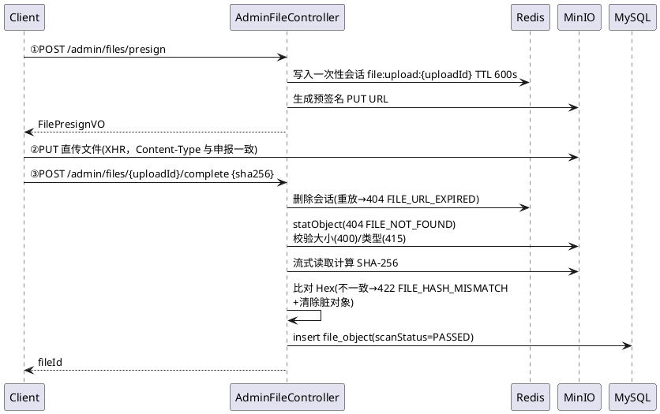

### 8.1 申请预签名上传地址

接口地址：`POST /api/v1/admin/files/presign`

请求体（FilePresignRequest）：

| 参数名称 | 参数类型 | 是否必填 | 说明 | 验证规则 |
| :--- | :--- | :--- | :--- | :--- |
| fileName | string | 是 | 原始文件名 | ≤255 字 |
| contentType | string | 是 | MIME 类型（须在用途白名单内） | ≤100 字 |
| fileSize | long | 是 | 文件大小（字节） | ≥1，不超过用途上限 |
| purpose | string | 是 | 文件用途 | AVATAR / ATTACHMENT / MESSAGE / TEMPLATE |

用途白名单与上限：

| purpose | 允许 MIME | 大小上限 |
| --- | --- | --- |
| AVATAR | image/jpeg、image/png、image/webp | 5MB |
| ATTACHMENT | image/jpeg、png、gif、webp + video/mp4 + application/pdf | 100MB |
| MESSAGE | image/jpeg、png + video/mp4 | 50MB |
| TEMPLATE | video/mp4、video/webm | 200MB |

响应 `data`（FilePresignVO）：

```json
{
  "code": "0",
  "msg": "OK",
  "data": {
    "uploadId": "9f2d…",
    "uploadUrl": "http://192.168.10.102:9000/rehab/attachment/uuid.pdf?X-Amz-Signature=…",
    "method": "PUT",
    "headers": {"Content-Type": "application/pdf"},
    "expiresInSec": 600
  }
}
```

错误码：400 VALIDATION_ERROR、413 FILE_TOO_LARGE、415 UNSUPPORTED_MEDIA_TYPE、424 STORAGE_UNAVAILABLE（MinIO 未启用/不可达）。对象键 = 用途前缀 + UUID + 清洗后扩展名；bucket 懒创建。审计：FILE/PRESIGN。

### 8.2 上传完成确认

接口地址：`POST /api/v1/admin/files/{uploadId}/complete`

请求体（FileCompleteRequest）：`sha256`（string，必填，64 位十六进制，与浏览器 `crypto.subtle.digest` 计算结果比对）。

响应 `data`：`fileId`（long）。错误码：404 FILE_URL_EXPIRED（会话不存在/已消费，**一次性**）、404 FILE_NOT_FOUND（对象未上传）、400（大小不符）、415（类型不符）、422 FILE_HASH_MISMATCH（哈希不符，脏对象已清除）、424 STORAGE_UNAVAILABLE。审计：FILE/COMPLETE。

### 8.3 获取文件预览地址

接口地址：`GET /api/v1/admin/files/{fileId}/url`

响应 `data`（FileUrlVO）：`fileId`、`fileName`、`contentType`、`fileSize`、`url`（短时预签名下载地址）、`urlExpiresAt`。错误码：404 FILE_NOT_FOUND。

### 8.4 删除文件

接口地址：`DELETE /api/v1/admin/files/{fileId}`，无请求体。

删除前检查 content_attachment / action_template_sample / consultation_attachment 引用，被引用 → 409 FILE_IN_USE。逻辑删除（手动 deletedAt，非 @TableLogic）。错误码：404、409 FILE_IN_USE。审计：FILE/DELETE。

---

## 模块九：公告管理（AdminAnnouncementController，/admin/announcements）

### 9.1 分页查询公告

接口地址：`GET /api/v1/admin/announcements`

Query：`page`、`size`、`status`（DRAFT/PUBLISHED/OFFLINE）、`scope`（ALL/PATIENT/THERAPIST）、`keyword`（标题模糊）。

响应 `data.records[]`（AdminAnnouncementVO）：`announcementId`、`title`、`content`、`scope`+`scopeName`、`status`+`statusName`、`startTime`、`endTime`、`createdBy`、`creatorName`、`createdAt`、`updatedAt`。

### 9.2 创建公告草稿

接口地址：`POST /api/v1/admin/announcements`

请求体（AnnouncementSaveRequest）：

| 参数名称 | 参数类型 | 是否必填 | 说明 | 验证规则 |
| :--- | :--- | :--- | :--- | :--- |
| title | string | 是 | 公告标题 | ≤200 字 |
| content | string | 是 | 公告正文 | — |
| scope | string | 是 | 可见范围 | ALL / PATIENT / THERAPIST |
| startTime | datetime | 否 | 展示开始时间（草稿可空） | `yyyy-MM-dd HH:mm:ss` |
| endTime | datetime | 否 | 展示结束时间（草稿可空） | 同上，且须 ≥ startTime |

响应 `data`：`announcementId`（DRAFT；有效期缺省兜底 now ~ now+30 天）。错误码：400 VALIDATION_ERROR（时间倒置）。审计：NOTICE/CREATE。

### 9.3 查询公告详情

接口地址：`GET /api/v1/admin/announcements/{announcementId}`，响应同 AdminAnnouncementVO（content 返回全文）。错误码：404 NOT_FOUND。

### 9.4 修改公告

接口地址：`PUT /api/v1/admin/announcements/{announcementId}`，请求体同 9.2。**仅 DRAFT/OFFLINE 可编辑，PUBLISHED → 409 STATE_CONFLICT**。审计：NOTICE/UPDATE。

### 9.5 发布公告

接口地址：`POST /api/v1/admin/announcements/{announcementId}/publish`

请求体（AnnouncementPublishRequest）：

| 参数名称 | 参数类型 | 是否必填 | 说明 | 验证规则 |
| :--- | :--- | :--- | :--- | :--- |
| startTime | datetime | 是 | 展示开始时间 | `yyyy-MM-dd HH:mm:ss` |
| endTime | datetime | 是 | 展示结束时间 | 同上，须 ≥ startTime |

仅 DRAFT/OFFLINE 可发布；PUBLISHED 重复发布 → 409 STATE_CONFLICT（先于参数校验）。发布后端侧（患者/治疗师只读接口）按 `status=PUBLISHED 且 now∈[start,end] 且 scope 匹配角色` 过滤。审计：NOTICE/PUBLISH。

### 9.6 下架公告

接口地址：`POST /api/v1/admin/announcements/{announcementId}/offline`，无请求体。仅 PUBLISHED → OFFLINE，其余 409。审计：NOTICE/OFFLINE。

### 9.7 删除公告

接口地址：`DELETE /api/v1/admin/announcements/{announcementId}`，无请求体。仅 DRAFT/OFFLINE 可删，PUBLISHED → 409。审计：NOTICE/DELETE。

---

## 模块十：康复部位字典（RehabPartDictAdminController，/admin/dictionaries/rehab-parts）

### 10.1 分页查询字典

接口地址：`GET /api/v1/admin/dictionaries/rehab-parts`

Query：`page`、`size`、`groupCode`（UPPER/LOWER/SPINE/OVERALL）、`keyword`。

响应 `data.records[]`（RehabPartDictVO）：`code`（业务主键）、`name`、`groupCode`、`sortNo`、`enabled`。

### 10.2 新增字典项

接口地址：`POST /api/v1/admin/dictionaries/rehab-parts`

请求体（RehabPartDictDTO）：

| 参数名称 | 参数类型 | 是否必填 | 说明 | 验证规则 |
| :--- | :--- | :--- | :--- | :--- |
| code | string | 是 | 部位编码（新增后不可变） | 大写字母开头，仅大写字母/数字/下划线，2~30 位 |
| name | string | 是 | 部位名称 | ≤50 字 |
| groupCode | string | 是 | 部位大类 | UPPER 上肢 / LOWER 下肢 / SPINE 脊柱 / OVERALL 全身综合 |
| sortNo | int | 是 | 排序号（升序，越小越前） | — |
| enabled | bool | 否 | 是否启用 | 缺省 true |

响应 `data=null`。错误码：409 DUPLICATE_RESOURCE（编码已存在）、400 VALIDATION_ERROR。审计：DICT/CREATE。

### 10.3 修改字典项

接口地址：`PUT /api/v1/admin/dictionaries/rehab-parts/{code}`，请求体同上（**编码以路径为准，不可改**）。错误码：404 NOT_FOUND。审计：DICT/UPDATE。

### 10.4 删除字典项

接口地址：`DELETE /api/v1/admin/dictionaries/rehab-parts/{code}`，无请求体。

删除前检查 4 张引用表：`action`、`health_content`、`rehab_plan`、`patient_rehab_part`，任一存在引用 → 409 STATE_CONFLICT（响应携带各表引用计数）。审计：DICT/DELETE。

---

## 模块十一：操作日志（AdminOperationLogController，/admin/operation-logs）

### 11.1 分页审计查询

接口地址：`GET /api/v1/admin/operation-logs`

Query：

| 参数名称 | 参数类型 | 是否必填 | 说明 | 验证规则 |
| :--- | :--- | :--- | :--- | :--- |
| page | int | 否 | 页码 | 默认 1 |
| size | int | 否 | 每页条数 | 默认 20 |
| module | string | 否 | 模块名 | AUTH/USER/BINDING/ACTION/CONTENT/FILE/NOTICE/DICT/BACKUP |
| operatorId | long | 否 | 操作人用户ID | — |
| from | datetime | 否 | 起始时间 | `yyyy-MM-dd HH:mm:ss` |
| to | datetime | 否 | 截止时间 | 同上 |

响应 `data.records[]`（AdminOperationLogVO）：`logId`、`userId`（NULL=系统操作）、`userName`（操作人账号）、`module`、`action`（LOGIN/CREATE/UPDATE/DELETE/PUBLISH/OFFLINE/AUDIT/RESTORE…）、`targetType`、`targetId`、`ip`、`deviceId`、`status`(SUCCESS/FAIL)、`detail`（JSON，请求参数或失败原因）、`createdAt`。

> 查询接口本身**不记录** operation_log，避免自日志噪声。

---

## 模块十二：备份恢复（AdminBackupController，/admin/backups）

整体流程：

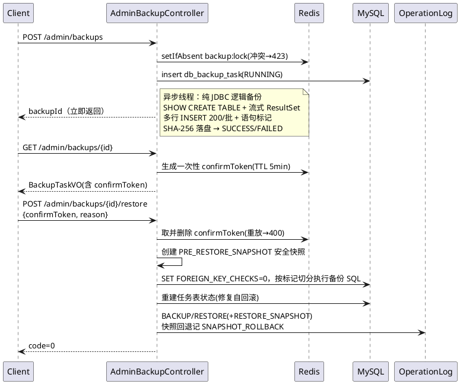

### 12.1 创建数据库备份

接口地址：`POST /api/v1/admin/backups`，无请求体。

异步执行纯 JDBC 逻辑备份（不依赖 mysqldump），立即返回任务ID。同一时刻仅允许一个备份/恢复（Redis `backup:lock`，UUID 值比对释放）。备份文件排除 `flyway_schema_history`，含 SHA-256 摘要。

响应 `data`：`backupId`（long，状态 RUNNING，轮询 12.2/12.3 获取终态）。错误码：423 RESOURCE_LOCKED。审计：BACKUP/CREATE。

### 12.2 分页查询备份任务

接口地址：`GET /api/v1/admin/backups`

Query：`page`、`size`、`status`（RUNNING/SUCCESS/FAILED）、`taskType`（BACKUP/PRE_RESTORE_SNAPSHOT）。

响应 `data.records[]`（BackupTaskVO）：`backupId`、`taskType`+`taskTypeName`、`status`+`statusName`、`filePath`、`fileSize`、`sha256`、`errorMsg`、`triggeredBy`、`operatorName`、`relatedBackupId`（恢复前快照指向目标备份）、`restoreReason`、`startedAt`、`finishedAt`、`createdAt`。列表接口**不含** confirmToken。

### 12.3 备份任务详情（获取恢复确认码）

接口地址：`GET /api/v1/admin/backups/{backupId}`

响应 `data`（BackupTaskVO，同上字段）+ `confirmToken`：**仅当任务 SUCCESS 且备份文件存在时下发**（BACKUP 与 PRE_RESTORE_SNAPSHOT 均可），一次性，TTL 5 分钟，存储于 Redis `backup:confirm:{backupId}`。

错误码：404 NOT_FOUND。

### 12.4 恢复备份（高危，二次确认）

接口地址：`POST /api/v1/admin/backups/{backupId}/restore`

请求体（BackupRestoreRequest）：

| 参数名称 | 参数类型 | 是否必填 | 说明 | 验证规则 |
| :--- | :--- | :--- | :--- | :--- |
| confirmToken | string | 是 | 一次性确认令牌（先调 12.3 获取） | 取出即删，重放 → 400 |
| reason | string | 是 | 恢复原因（审计留痕） | ≤500 字 |

行为约定：

- 目标须为 SUCCESS 的 BACKUP 或 PRE_RESTORE_SNAPSHOT，其余 400/409。
- 恢复普通备份前自动生成 PRE_RESTORE_SNAPSHOT 安全快照（`relatedBackupId` 指向目标）；**恢复快照本身不再递归建快照**（快照回退，审计 kind=SNAPSHOT_ROLLBACK）。
- 恢复完成后重建 db_backup_task 任务状态（逻辑恢复会回滚任务表自身），RESTORE 审计于恢复完成后补发。
- 失败时任务标记 FAILED 并记录 errorMsg，提示可用快照ID回退。

响应 `data=null`。错误码：400 VALIDATION_ERROR（令牌缺失/重放/类型非法）、404、409 STATE_CONFLICT（任务非成功态/文件缺失）、423 RESOURCE_LOCKED。

---

# 附：错误码总表（管理端涉及部分）

| HTTP | code | 说明 | 典型场景 |
| --- | --- | --- | --- |
| 400 | VALIDATION_ERROR | 请求参数错误 | 参数校验失败、非法 JSON、时间倒置、confirmToken 重放 |
| 400 | CAPTCHA_INVALID | 验证码错误或过期 | 登录前置 |
| 401 | AUTH_REQUIRED | 未登录或会话过期 | 无 Bearer Token |
| 401 | TOKEN_EXPIRED / TOKEN_INVALID | 令牌过期/非法 | — |
| 401 | ACCOUNT_DISABLED | 账号已被禁用 | 禁用后令牌立即失效 |
| 403 | FORBIDDEN | 无权限 | 非 ADMIN 访问 /admin/** |
| 404 | NOT_FOUND | 资源不存在 | 通用 |
| 404 | VERSION_NOT_FOUND | 动作版本不存在 | M2 |
| 404 | FILE_NOT_FOUND | 文件不存在 | 8.2/8.3 |
| 404 | FILE_URL_EXPIRED | 直传会话过期/已消费 | 8.2 |
| 409 | DUPLICATE_RESOURCE | 唯一冲突 | 用户名、字典编码 |
| 409 | STATE_CONFLICT | 状态机不允许 | 内容/公告/绑定/字典引用/动作下线 |
| 409 | VERSION_IMMUTABLE | 已发布版本不可修改 | M2 版本/规则/模板 |
| 409 | BINDING_CONFLICT | 主责唯一/有效期冲突 | 2.2 |
| 409 | FILE_IN_USE | 文件被引用不可删 | 8.4 / 6.4 |
| 413 | FILE_TOO_LARGE | 超大小上限 | 8.1 |
| 415 | UNSUPPORTED_MEDIA_TYPE | MIME 非白名单 | 8.1/8.2 |
| 422 | PLAN_PARAMETER_INVALID | 权重和≠1 等参数越界 | 4.5 |
| 422 | FILE_HASH_MISMATCH | SHA-256 不一致 | 8.2 |
| 423 | RESOURCE_LOCKED | 备份/恢复互斥锁 | 12.1/12.4 |
| 424 | STORAGE_UNAVAILABLE | MinIO 不可用 | 8.x |
| 500 | INTERNAL_ERROR | 服务端异常（带 traceId） | — |
